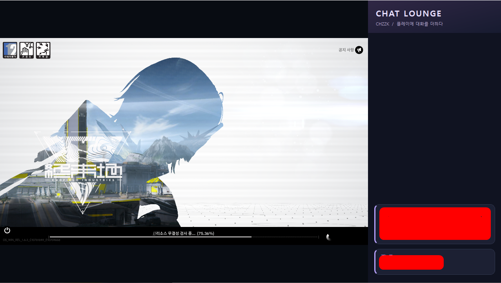

# 게임 + 치지직 채팅 녹화용 창 — Python

실제 게임 위에 띄우는 **채팅 오버레이**와, **게임 화면 + 오른쪽 채팅 패널을 합친 OBS 녹화용 창**을 제공합니다.
OBS에서는 녹화용 창 하나를 윈도우 캡처하면 됩니다. 실제 게임 조작은 원래 게임 창에서 합니다.

## 사용 화면



게임 화면과 커스텀 채팅 패널을 하나의 창에 나란히 표시한 실제 사용 예시입니다. 스크린샷의 채팅 내용은 사용자가 가린 상태입니다.

## OBS Lua 확장 (실험 버전)

별도 Python 수신기 없이 OBS 내부에서 치지직 채팅을 받고, 게임 + 채팅 합성 장면과 게임 위 채팅 오버레이를 구성할 수 있습니다. 설치된 폰트 선택과 Ctrl+Alt+F8 클릭 통과 전환을 지원합니다.

[OBS Lua 확장 사용 안내](obs-plugin/README.md) · [Lua 전용 배포 다운로드](https://github.com/NoteBlockMR/GameChzzk-ChatScreen/releases/tag/obs-lua-v0.1.1)

Windows x64 OBS용입니다. 기존 독립 실행형 앱 v1.1.7과 별도로 배포하며, 실제 OBS/게임 환경에서의 최종 검증이 필요한 실험 버전입니다.

## 실행

Windows 10/11, Python 3.10 이상:

```powershell
python -m pip install -r requirements.txt
python main.py
```

현재 작업 폴더에 준비된 환경으로는 아래 한 줄로 실행합니다.

```powershell
.\.venv\Scripts\python.exe main.py
```

## 사용법

### 게임과 채팅을 합친 녹화용 창

1. 게임을 창 모드 또는 테두리 없는 전체 화면으로 실행합니다.
2. 앱에 치지직 채널/라이브 주소를 입력하고 **채팅 연결**을 누릅니다.
3. **OBS 녹화용 창**에서 게임 창을 선택하고 **게임 연결 · 녹화용 창 열기**를 누릅니다. 목록에 없으면 새로고침하세요.
4. 새로 열린 **CHZZK 게임 + 채팅 — OBS 녹화용** 창에 왼쪽 게임, 오른쪽 채팅이 표시됩니다. 설정 버튼은 녹화용 창 밖에 있습니다.
5. 설정에서 출력 크기(1280×720 / 1920×1080), 채팅 폭(280~500px), 채팅 글자 크기(12~24px)를 조절합니다. **채팅 폰트**에서 Windows에 설치된 폰트를 선택하면 두 채팅 패널에 즉시 적용되고 다음 실행에도 유지됩니다. 새 폰트를 설치한 후에는 앱을 다시 실행하세요.
6. OBS에서 **윈도우 캡처** 소스를 하나 추가하고 위 녹화용 창을 선택합니다. 캡처 방식은 **Windows 10(1903 이상)**, **클라이언트 영역 캡처**는 켜세요. OBS의 게임 캡처 소스가 아니라 윈도우 캡처를 사용합니다.
7. 게임 소리는 OBS에서 응용 프로그램 오디오 캡처 또는 데스크톱 오디오로 별도 설정하고, 미리보기와 오디오 미터를 확인한 뒤 녹화합니다.

게임과 녹화용 창을 최소화하지 마세요. 다른 창 뒤에 놓을 수는 있습니다. 게임 화면은 비율을 유지하며 남는 공간에는 검은 여백이 생깁니다. 캡처는 약 30fps로 갱신됩니다. 게임의 제목 표시줄이 포함될 수 있어 테두리 없는 창 모드를 권장합니다. 보호된 게임/독점 전체 화면에서는 캡처가 제한될 수 있습니다.

녹화용 창을 닫으면 게임 캡처를 중지합니다. **게임 연결 · 녹화용 창 열기**로 다시 시작할 수 있습니다. 게임 종료 시 마지막 프레임을 지워 멈춘 영상을 계속 표시하지 않습니다.

채팅은 **독립적인 CHAT LOUNGE 패널**로 표시합니다. 공식 페이지를 숨긴 수신기로 사용하고, 닉네임과 메시지는 Qt 위젯으로 직접 그립니다. 짙은 남색 카드와 사용자별 파스텔 포인트를 사용하며, 공식 메뉴·공지·로그인 입력칸·후원 버튼은 녹화 화면에 표시하지 않습니다. 최근 100개까지 표시하고 제재/삭제된 메시지는 목록에서 제거합니다. 로그인이나 연결 상태 확인은 설정의 **로그인 · 연결 확인**으로 별도 창을 여세요. 현재 메시지는 일반 텍스트로 표시하며 치지직 전용 이미지 이모티콘은 텍스트 코드로 보일 수 있습니다. 수신은 공식 페이지 내부 메시지 구조에 의존하므로 치지직 업데이트 시 대응이 필요할 수 있습니다.

### 게임 화면이 연결 중에서 멈추는 경우

기본값 **자동 (실패 시 화면 영역 캡처)**는 창 캡처 시작 오류 또는 첫 프레임 5초 대기 후 호환 모드로 전환합니다. 설정 창의 **현재 캡처 방식**에서 실제 방식을 확인하세요. 호환 모드가 되면 **원래 게임으로 돌아가기**를 눌러 게임을 앞으로 가져옵니다. 다른 창이 함께 찍히는 것을 원하지 않으면 **게임 창 캡처만 사용**을 선택하세요.

첫 프레임을 5초 동안 받지 못하면 녹화용 창에도 안내를 표시합니다. 게임 최소화를 해제하고 창 모드/테두리 없는 창 모드를 사용해 보세요. 계속 안 되면 **캡처 방식 → 화면 영역 캡처(호환 모드)**로 바꾼 뒤 **게임 연결**을 다시 누릅니다.

호환 모드는 게임 창 자체 대신 모니터에 보이는 게임 영역을 가져옵니다. **원래 게임을 맨 앞으로 가져오고 녹화용 창은 그 뒤에 두세요.** 녹화용 창이 맨 앞이면 반복 캡처 방지를 위해 대기합니다. 게임을 최소화하면 미리보기를 비우고 복원되면 다시 받습니다. 겹쳐 있는 다른 창과 게임 위 오버레이도 캡처됩니다. 채팅이 중복되면 Ctrl+Alt+F9로 게임 위 오버레이만 숨기세요. 화면 밖에 걸친 부분은 캡처되지 않습니다. 보호된 영상이나 일부 독점 전체 화면은 호환 모드에서도 지원하지 않을 수 있습니다.

### 실제 게임 위 채팅 오버레이

1. 게임을 **창 모드 또는 테두리 없는 전체 화면**으로 실행합니다.
2. 설정 창에 치지직 채널/라이브 주소를 입력하고 **채팅 연결**을 누릅니다.
3. 채팅창 위쪽 막대를 드래그하여 게임 위 원하는 위치로 이동합니다. 오른쪽 아래 모서리로 크기를 조절합니다.
4. 필요하면 불투명도를 낮춰 게임이 비쳐 보이도록 합니다. 채팅 글자도 함께 옅어집니다.
5. **게임 모드 켜기**를 누르면 이동 막대와 크기 조절 손잡이가 사라지고, 채팅창 위 마우스 클릭이 뒤의 게임으로 통과합니다.
6. 원래 게임을 클릭하거나 Alt+Tab으로 게임에 돌아갑니다. 설정 창은 최소화해도 채팅창이 남습니다.

게임에 포커스가 있어도 사용하는 전역 단축키:

| 단축키 | 기능 |
|---|---|
| Ctrl+Alt+F8 | 게임 모드 ↔ 편집 모드 |
| Ctrl+Alt+F9 | 채팅 숨기기 ↔ 표시 |

설정 창은 작업 표시줄 오른쪽 **트레이 아이콘 클릭** 또는 우클릭 → **설정 창 열기**로 엽니다. 아이콘이 보이지 않으면 숨겨진 아이콘(∧)을 확인하세요. 편집 모드에서는 오버레이 상단 이동 막대를 더블클릭해도 됩니다. Ctrl+Alt+F10은 다른 프로그램과의 충돌 때문에 제거했습니다.

단축키 충돌이 발생하면 설정 창에 표시합니다. Alt+Tab으로 설정 창에 돌아와 버튼을 사용해도 됩니다. 채팅 입력/로그인은 설정의 **로그인 · 연결 확인** 창에서 진행합니다. 설정 창을 닫으면 앱이 종료됩니다. 채널, 위치, 크기, 불투명도는 저장되며, 다음 실행은 편집 모드로 시작합니다.

## OBS 브라우저 소스를 직접 사용하는 대안

기본 사용법은 위의 **녹화용 창 하나 캡처**입니다. 녹화용 창 대신 OBS에서 직접 합성하려면 아래 방식도 사용할 수 있습니다. 채팅 URL은 `https://chzzk.naver.com/live/{32자리 채널ID}/chat?theme=dark`입니다.

1. OBS의 같은 장면에 **게임 캡처** 소스를 추가하여 게임을 선택합니다.
2. **브라우저** 소스를 추가하고 이름을 `치지직 채팅`으로 지정합니다.
3. 위 채팅 URL을 붙여 넣고 너비·높이를 입력합니다. `로컬 파일`은 끕니다.
4. OBS 소스 목록에서 **치지직 채팅을 게임 캡처보다 위에** 배치합니다.
5. 미리보기에서 채팅을 원하는 위치·크기로 배치하고 소스를 잠급니다. 오디오 믹서에서 게임 소리를 확인한 다음 녹화를 시작합니다.

이 구성에서는 실제 게임 위 오버레이와 녹화용 채팅을 함께 사용할 수 있습니다. **Ctrl+Alt+F9로 게임 위 오버레이를 숨겨도 OBS 채팅은 유지**됩니다. 녹화에서 채팅을 숨기려면 OBS에서 해당 소스의 눈 아이콘을 끄세요.

OBS는 별도 브라우저 세션이므로 필요하면 소스 우클릭 → **상호작용**에서 로그인합니다. 채널을 변경하면 OBS URL도 다시 복사해야 하며, 위치와 불투명도는 자동 동기화되지 않습니다. 녹화용 불투명도는 OBS 소스의 색상 보정 필터에서 조절할 수 있습니다. 앱은 OBS 설정을 자동 변경하거나 녹화를 시작하지 않습니다.

**게임 위에서 보이는 위치·불투명도까지 그대로 녹화**하려면 OBS에 **디스플레이 캡처**를 추가하여 게임과 채팅이 있는 모니터를 선택하세요. 이 경우 그 모니터의 다른 창도 포함됩니다. 디스플레이 캡처에는 오버레이가 이미 들어 있으므로 별도 채팅 브라우저 소스를 중복으로 표시할 필요가 없습니다.

## 지원 범위

### 채팅 금지·추방 시 기존 채팅 숨김

오버레이와 녹화용 채팅 모두 공식 웹 채팅이 수신한 채팅 금지(MUTE), 추방(BAN/KICK), 일시·활동 제한 알림을 감지하면 **해당 사용자 ID의 제재 시점 이전 메시지**를 화면에서 숨깁니다. 닉네임이나 일반 채팅 문구로 제재를 추측하지 않습니다. 개별 메시지 삭제 알림은 그 메시지만 숨깁니다. 제재 해제 후 새 메시지는 표시하지만 이미 지운 과거 메시지는 복원하지 않습니다.

이 기능은 앱 화면에만 적용됩니다. 치지직 서버 기록이나 이미 녹화된 영상은 변경하지 않습니다. 페이지가 수신하지 못한 제재(접속 이전 제재 포함)는 알 수 없으며, 새로고침하면 앱의 임시 제재 기록은 초기화됩니다. 공식 웹 페이지의 수신 패킷 및 React 메시지 구조에 의존하므로 치지직 변경 시 조정이 필요할 수 있습니다. 사용자 ID를 확인할 수 없는 행은 다른 사람의 메시지 삭제를 방지하기 위해 임의로 숨기지 않습니다.

로컬 제재 이벤트 검증: `.\.venv\Scripts\python.exe tests\moderation_smoke.py`

- Windows 최상위 창으로 실제 게임 위에 겹쳐 보이는 오버레이입니다. 게임 프로세스 안에 주입하거나 게임 렌더링을 수정하지 않습니다.
- **독점 전체 화면은 지원하지 않습니다.** 채팅이 안 보이면 게임을 테두리 없는 창 모드로 바꾸세요.
- 채팅은 치지직 공식 팝업 페이지를 사용합니다. API 키는 필요하지 않으며, 로그인·방송·채널 제한은 치지직에서 처리합니다.
- 오버레이만 사용할 때는 게임 선택이나 OBS 실행이 필요 없습니다. 녹화용 창은 게임 창을 선택해야 합니다.
- OBS의 **게임 캡처**에는 이 별도 오버레이 창이 자동으로 포함되지 않습니다. 방송에도 함께 보이게 하려면 디스플레이 캡처 또는 별도 채팅 소스를 사용하세요.

## 코드와 검증

- `main.py`: 채팅 오버레이, 설정 창, 녹화용 창 제어
- `recording.py`: 게임 + 오른쪽 채팅을 합친 녹화용 창
- `capture.py`: Windows Graphics Capture와 창 목록
- `chat_theme.py`: 공식 채팅 페이지 스타일과 글자 크기
- `hotkeys.py`: Windows 전역 단축키 등록/해제
- `obs_setup.py`: OBS 동시 녹화 설정 안내, 채팅 URL 복사, 크기 안내
- `channel.py`: 치지직 주소 검증
- `requirements.txt`: PySide6, windows-capture 의존성

```powershell
.\.venv\Scripts\python.exe -m unittest discover -s tests
.\.venv\Scripts\python.exe tests\smoke.py
.\.venv\Scripts\python.exe tests\recording_smoke.py
```

이전 시안은 `.legacy-electron/`, `.legacy-preview/`에 보관되어 있으며 실행에 사용하지 않습니다.

녹화 테스트는 외부 테스트 창을 실제 캡처하고 합성된 출력 창을 다시 Windows 캡처하여 게임과 웹 채팅 영역이 함께 나오는지 확인합니다. 실제 라이브 메시지 수신이나 OBS 파일 녹화까지 검증하는 테스트는 아닙니다.

참고: [Qt 창 입력 통과](https://doc.qt.io/qt-6.12/qt.html), [Windows 전역 단축키](https://learn.microsoft.com/en-us/windows/win32/api/winuser/nf-winuser-registerhotkey), [OBS 게임 캡처](https://obsproject.com/kb/game-capture-source).
